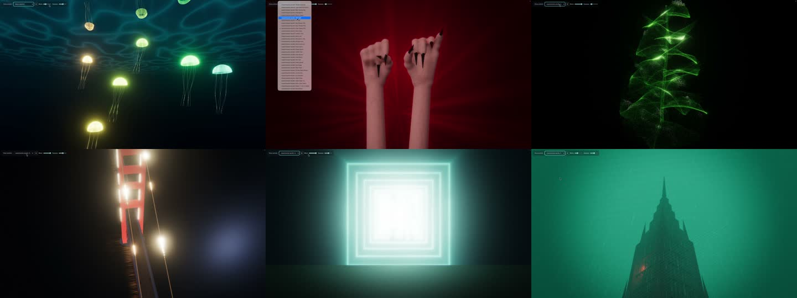
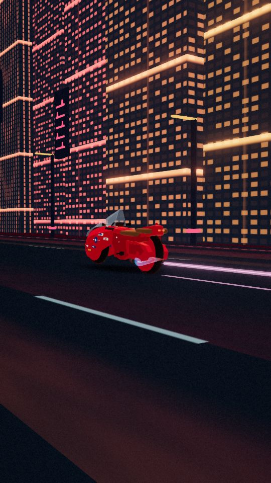
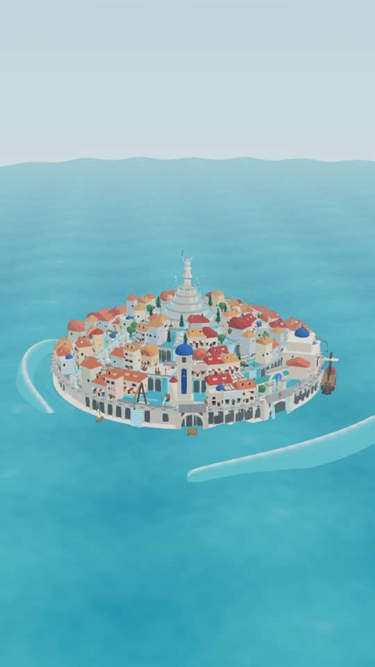
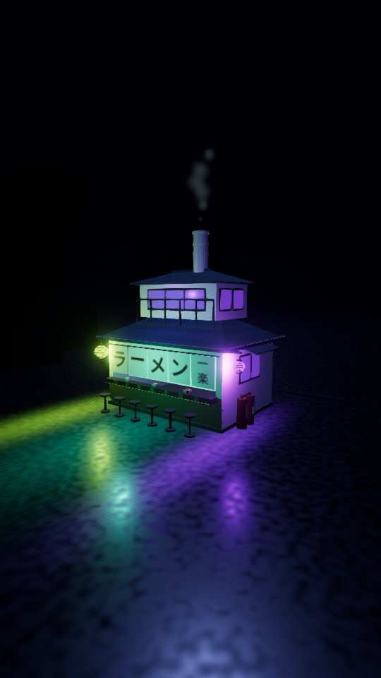

# Music / Audio Visualizer

A free music visualizer that runs entirely in your browser. Choose from 100+ music-reactive scenes for personal listening, visual experiments, house parties, clubs, or DJ sets. WebGPU powers the visuals, with a WebGL2 compatibility fallback.

Visualize audio from apps such as Spotify, YouTube, Apple Music, or VirtualDJ through browser or system-audio capture, where supported. You can also load local music files directly. Audio analysis happens on your device. App compatibility depends on your browser, operating system, and audio routing; external DJ hardware, including Pioneer DJ equipment, needs its audio routed through the computer for capture.

Tested in Chrome on an Apple M2 Pro, including separate 30-minute WebGPU and WebGL2 reliability sessions. Performance varies by GPU, scene, resolution, and quality setting; other hardware and browsers are not yet verified. See the [release verification results](docs/stage5-results.md).

## Preview

[](docs/media/visualizer-demo.mp4)

[Watch or download the full demo recording](docs/media/visualizer-demo.mp4) — 5 minutes 48 seconds, 720p, with audio.

A few more scenes from existing captures:

| Akira | Water 7 | Ichiraku |
| --- | --- | --- |
|  |  |  |

## Run locally

Requires Node.js 22.12+ (22.x) or 24.x.

```sh
npm ci
npm run dev
```

Open [http://127.0.0.1:5173/](http://127.0.0.1:5173/). The visualizer opens at the root URL.

Choose a scene, then load a track or select **Use audio playing on this Mac**. For live audio, choose a tab or screen in the browser's share picker and enable audio sharing if offered. Start with **Balanced** quality and **Auto** render scale. If graphics fail, use **Restart renderer** or **Restart in WebGL2**.

To build and preview the production version:

```sh
npm run build
npm run preview
```

Serve the app through localhost or HTTPS; opening the HTML directly with `file://` is unsupported.

## Roadmap

### Phase 1 — Initial visualizations · Complete

- Created an initial collection of 100+ scenes that react to music.
- Added support for local audio files and browser/system-audio capture where available.

### Phase 2 — Rendering upgrades and release stabilization · Complete

- Moved rendering to WebGPU, with a WebGL2 compatibility fallback.
- Added volumetric lighting, richer GPU particles, transitions, and improved controls.
- Verified recovery from graphics failures and long-session reliability on the reference Chrome/M2 Pro setup.
- Made the visualizer the default at `/` and removed the old implementation.

See the [Stage 4 rendering results](docs/stage4-results.md) and [Stage 5 release results](docs/stage5-results.md) for the tested scope and limitations.

### Phase 3 — Visualization improvements · Current

- Refine existing visualizations using community feedback.

### Phase 4 — UI improvements · Planned

- Improve scene browsing, controls, and usability.

### Phase 5 — Webcam-reactive visuals · Planned

- Add webcam-driven visual effects.

### Phase 6 — Road to 200 visualizations · Planned

- Expand the collection toward 200 visualizations.
