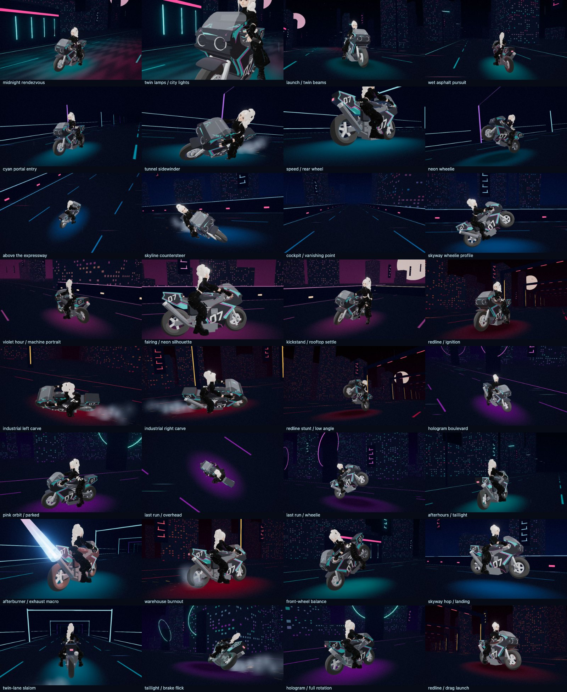

# Night Rider V2

Select **`<Experimental Wave6> Night Rider V2`**, or open
`/modern.html?mode=nightRiderV2`. The original **Night Rider** remains bike-only.

V2 shares the original 32-shot reel, six districts, six authored bike clips,
procedural stunts, beat-driven exhaust, embers, drift sparks, tyre smoke and
acceleration effects. Its wider camera views provide extra rider headroom.

The supplied `/Users/sabarnoislam/Downloads/output.glb` is copied unchanged to
`src/assets/wave6/nr_rider_v2.glb` (5,778,720 bytes). SHA-256:
`640674b28adda7a0d623a2e51a72fc1afee0eab9431eb9216e0f7ff5ff23f59c`.
It contains one textured A-pose mesh, with no skeleton or animation clips.
V2 builds a model-specific 15-bone runtime rig, smooths skin weights over the
mesh topology and UV seams, and solves seated arm/leg poses. It follows the
animated bike frame through leans, wheelies, jumps and braking, with breathing,
head movement, acceleration tuck and an experimental stand-beside transition.
The original face and clothing texture are retained under a cel/rim shader.

This is an experimental animation adaptation. The loose trousers and long
braid can still compress or intersect the body/bike in close views; fingers
and hair do not have separate articulated rigs. An artist-authored skeleton,
skin weights, hand grips and seated animation would improve close-up quality.
These are asset limitations, not something switching render backends fixes.
The source asset and original bike-only mode remain intact.

Headless Playwright covers all shots, visible exhaust output, drift particles,
finite deformed vertices, normalized skin weights, stretched-triangle limits,
reduced-motion freezing, disposal and switching between modes. It does not
measure native GPU frame rates or certify the asset's commercial licensing.

Regenerate both editions' review sheets against the user's running server:

```sh
PLAYWRIGHT_BASE_URL=http://127.0.0.1:5186 CAPTURE_NIGHT_RIDER=1 npx playwright test tests/browser/nightRider.spec.ts --project=compatibility
```


