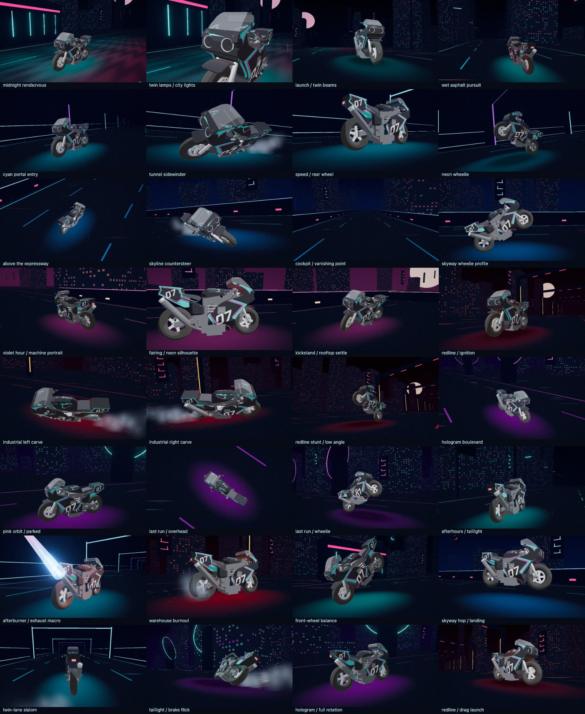

# Night Rider

Select **`<Experimental Wave6> Night Rider`** in the modern visualizer, or open
`/modern.html?mode=nightRider`. Recommended starting settings: Balanced quality,
bloom 0.35 (selected automatically), exposure 1 and FXAA.

This is now a bike-only reel: 32 shots across rain street, light tunnel, skyway,
dusk overlook, redline works and hologram plaza. It retains all six authored
bike clips (the former dismount is a kickstand/parking animation), and adds
procedural drifting, burnout, launch, slalom, front-wheel balance, a small hop
and a full product rotation. Cameras include fairing, headlight, exhaust,
wheel, chase, cockpit, overhead and orbit views. Fresh musical onsets can
shorten cruising shots; stunts and full rotations finish before cutting.

Bass and bounce drive road speed. Fresh beat, impact or bounce edges provide
short acceleration kicks and occasional blue/orange exhaust backfires, with
embers emitted from the animated outlet. Sustained audio does not leave the
flame constantly on: there is a cooldown, and every third trigger skips the
backfire. Rear-tyre contact sparks and smoke trail during drifting and burnouts.
Speed kicks widen the lens slightly and stretch road light streaks. Reduced
motion freezes animation and particles; reduced flash limits particle and
flame intensity and removes cut accents. Silent playback still tours the bike.

The only runtime model is `src/assets/wave6/nr_bike.glb` (3,358,440 bytes),
unchanged from `night_rider_v1_3_release.zip`. The rider GLB and appearance code
remain in the project for reference, but this mode neither imports nor loads
them. Original model geometry and animation tracks are preserved. Extra motion
is layered on the bike's outer group; exhaust emitters follow its actual moving
outlet. Scenery and graphics are procedural, with no new fonts, plates or logos.

City blocks are instanced and static scenery is batched by material. Particle
pools are bounded and scale with quality; their small radial mask is generated
in memory and disposed with the mode. Source geometries are cloned before use.
Unit checks exercise pacing, silence, throttle edges, cooldowns, freezing and
the bike asset contract. Headless Playwright checks all 32 shots, absence of
rider asset requests, spark emission, exhaust beats, stunt motion, reduced
flash/motion, fewer than 200 draws per frame, and application mode switching.
These checks do not measure native GPU frame rates on a live show system.

Regenerate the contact sheet with:

```sh
CAPTURE_NIGHT_RIDER=1 npx playwright test tests/browser/nightRider.spec.ts --project=compatibility
```

To check an already running server, prefix that command with
`PLAYWRIGHT_BASE_URL=http://127.0.0.1:5186`. This skips starting another server.


