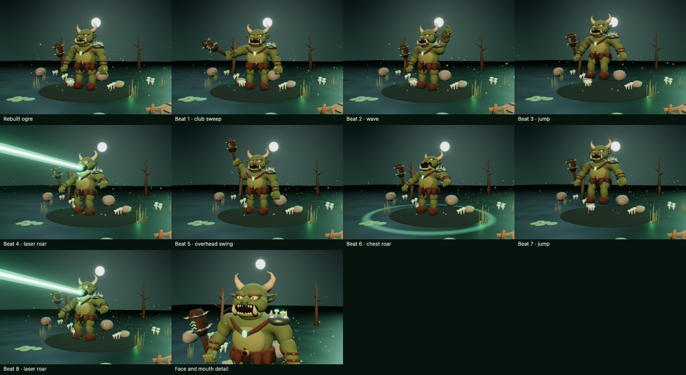

# Swamp Ogre — consolidated model and performance

The rebuilt `swampGiant` uses the versioned [GLB](../../../src/assets/models/swamp_giant.glb), [Blender authoring script](../../../scripts/build_ogre.py), and [procedural performance](../../../src/modes/giantPerformance.ts). No Blender installation is needed to run the app.

Model size: 2,690,532 bytes. SHA-256: `efc7bc356a999e35e6c8bfe9fd28b87ecf992d1b1960e3adb99df13f165d3874`.

The detailed rig includes a working jaw, mouth emitter and club-tip socket. Distinct beats drive club sweeps, waves, jumps, laser roars, overhead swings and chest roars. The pose settles after landing, limits repeated onsets and flashes, and freezes under reduced motion. Shared figure instantiation owns geometry; the Ogre does not make a redundant second copy.

The review below uses synthetic beats through the native WebGPU fixture. Dedicated browser checks pass on native WebGPU and software WebGL2, including visible laser pixels, mouth alignment, finite skinning, foot placement, reduced motion and reopening the scene. Unit tests validate normalized skin weights, the rig, action sequencing and comfort settings.

[Portrait](portrait.jpg) · [Face detail](detail.jpg)

Run `npm run test:browser:ogre` for the browser checks and `npm test -- --maxWorkers=2` for the unit suite. Captures come from the isolated project fixture, not desktop capture.
